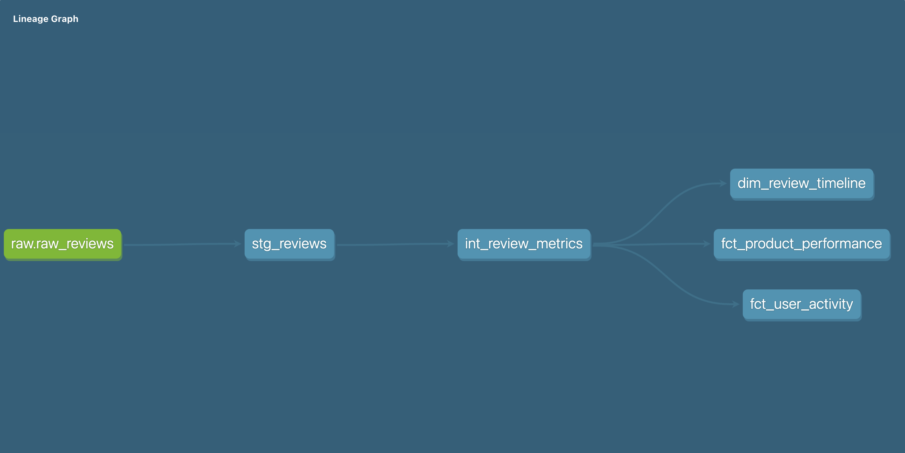

# Yelp Reviews Analytics Pipeline (dbt + PostgreSQL)

[](https://github.com/devanshi4/dbt-yelp-analytics-pipeline/actions/workflows/dbt-ci.yml)

A dbt project that loads 2,000 reviews from the Hugging Face `yelp_review_full` dataset into PostgreSQL and models them through staging → intermediate → marts layers, with data quality tests and generated documentation.

<p align="center">
  
</p>

## Architecture

```
Hugging Face dataset → Python loader → PostgreSQL (raw_reviews) → dbt staging → intermediate → marts
```

1. **Ingestion** — `data_ingestion/load_data.py` pulls the first 2,000 reviews and writes them to `public.raw_reviews`.
2. **Staging** — `stg_reviews` cleans and standardizes the raw columns and derives a sentiment label from the rating.
3. **Intermediate** — `int_review_metrics` (ephemeral) adds per-review flags: positive/negative, verified, has helpful votes, and review length category.
4. **Marts** — `fct_product_performance`, `fct_user_activity`, and `dim_review_timeline` (incremental).

## A note on the data

`yelp_review_full` contains only review text and a star label (0–4, mapped to 1–5 stars). It has no business IDs, reviewer IDs, or review dates. The loader therefore assigns placeholder IDs (`BUSINESS_<n>`, `USER_<n>`) and the load time as the review timestamp. The product, user, and timeline marts show the modeling patterns (aggregation grain, scoring logic, incremental loading). With this dataset they are not meaningful per-business, per-user, or time-trend insights. Pointing the loader at a dataset with real IDs and dates would make them so.

## Tech stack

| Layer | Tool |
|---|---|
| Source | Hugging Face Datasets (`yelp_review_full`) |
| Loader | Python, pandas, SQLAlchemy |
| Warehouse | PostgreSQL |
| Transformation & tests | dbt (dbt-postgres) |
| CI | GitHub Actions (`dbt parse`) |

## Project structure

```
dbt-yelp-analytics-pipeline/
├── data_ingestion/
│   └── load_data.py              # Hugging Face → PostgreSQL
├── dbt_project/analytics_project/
│   ├── models/
│   │   ├── staging/              # stg_reviews + source and column tests
│   │   ├── intermediate/         # int_review_metrics
│   │   └── marts/                # fct_product_performance, fct_user_activity, dim_review_timeline
│   ├── profiles.example.yml      # Copy to ~/.dbt/profiles.yml
│   └── dbt_project.yml
├── .env.example
└── Lineage_Graph.png
```

## Running it

```bash
git clone https://github.com/devanshi4/dbt-yelp-analytics-pipeline.git
cd dbt-yelp-analytics-pipeline
pip install dbt-postgres datasets pandas sqlalchemy psycopg2-binary

# 1. Configure the connection (database dbt_analytics must exist)
cp .env.example .env            # fill in your Postgres credentials
set -a; . ./.env; set +a
mkdir -p ~/.dbt && cp dbt_project/analytics_project/profiles.example.yml ~/.dbt/profiles.yml

# 2. Load raw data
python data_ingestion/load_data.py

# 3. Build and test the models
cd dbt_project/analytics_project
dbt build
dbt docs generate && dbt docs serve   # lineage and docs at http://localhost:8080
```

## Key models

**fct_product_performance** — per-product review counts, average rating, sentiment distribution, verification rate, and a 0–100 product health score.

**fct_user_activity** — per-reviewer volume, rating patterns, and a reviewer quality score.

**dim_review_timeline** — one row per product per day: review count, unique reviewers, average rating, positive/negative counts, helpful votes and verified reviews. Built incrementally, so each run processes only new days.

## Data quality

Tests are defined in the staging and mart YAML files:
- `not_null` on key and required columns (8 tests)
- `unique` on primary keys (3 tests)
- `accepted_values` on categorical fields (2 tests)

CI runs `dbt parse` on every push and pull request to catch broken SQL, Jinja, refs, and YAML.

## Roadmap

- Swap in a review dataset with real business IDs, reviewer IDs, and dates
- Add relationship tests between marts and staging
- Run `dbt build` in CI against a Postgres service container with a small fixture
- Add dbt snapshots for slowly changing attributes

## Author

**Devanshi Pandya** · [LinkedIn](https://www.linkedin.com/in/devanshi4/) · [GitHub](https://github.com/devanshi4)
